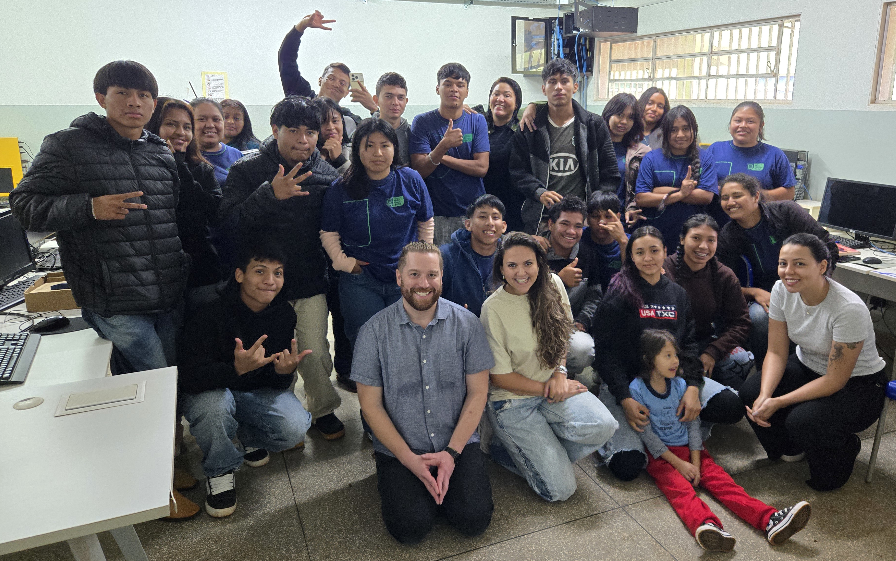

::: {#index-subtitle}
Apoiando Povos Indígenas na Construção da Autonomia em Saúde Pública
:::

O Instituto Dourados é uma organização de pesquisa e educação que apoia
comunidades indígenas na construção de maior autonomia para planejar e conduzir
seus próprios futuros em saúde pública.

Nossa missão é transformar pesquisa básica em ferramentas práticas que
fortaleçam a capacidade comunitária em saúde pública. Combinamos epidemiologia,
ciência social quantitativa, modelagem computacional e parcerias de longo prazo
para desenvolver infraestrutura científica e computacional sustentável que as
próprias comunidades possam operar, manter e aperfeiçoar. Saiba mais sobre nossa
visão de longo prazo na página de [Missão](mission.qmd).

{width=480px .lightbox}

Ao documentarmos abertamente nossos métodos, softwares e pesquisas sempre que
possível, esperamos que outras pessoas e organizações possam ampliar nossos
sucessos e aprender com nossos desafios.

Realizamos esse trabalho em parceria com organizações da Reserva Indígena de
Dourados e com docentes, pesquisadores e estudantes da Universidade Federal da
Grande Dourados (UFGD).

### Organização Beneficente 501(c)(3)

As doações destinadas ao Instituto Dourados são dedutíveis do imposto de renda
nos Estados Unidos. Somos um Instituto  da organização beneficente
reconhecida pelo governo federal dos Estados Unidos como isenta de impostos sob
a seção 501(c)(3), a [Generation of Participation in Democracy
(GPD)](https://gpd.network).

**Employer Identification Number (EIN): 41-4992913**

A Generation of Participation in Democracy é uma corporação de benefício público, sem fins lucrativos, registrada no Estado da Califórnia e em conformidade com as exigências do Departamento de Justiça da Califórnia para organizações beneficentes.

### Fique Conectado

<iframe src="https://docs.google.com/forms/d/e/1FAIpQLSerQly0QI9YOhfjtkBXcCI1o6ktymFB1us33w3zbFd4NPpmIA/viewform?embedded=true" width="640" height="502" frameborder="0" marginheight="0" marginwidth="0">

Loading…

</iframe>

